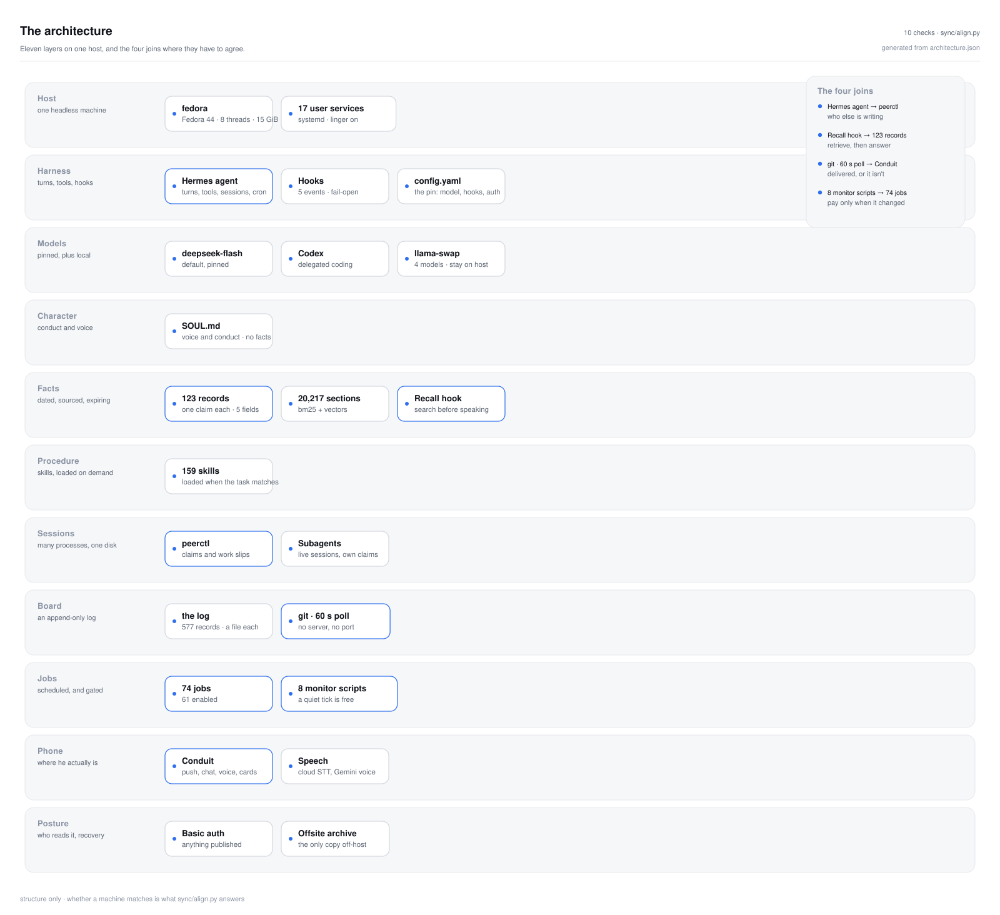

# agent-architecture

An architecture, written down as something a machine can check — so "are we aligned?" is a
command instead of a message.

<picture>
  <source media="(prefers-color-scheme: dark)" srcset="docs/architecture-dark.svg">
  
</picture>

## What it is

One host running an agent: eleven layers, and four places where they have to agree. The picture
is generated from [`architecture.json`](architecture.json) — one file saying what exists and what
talks to what, with the joins written out rather than drawn as spaghetti.

[`sync/profile.json`](sync/profile.json) is the half that can be wrong: ten decisions, each with
the check that runs on the machine which has to match. [`sync/align.py`](sync/align.py) runs them
and answers aligned / drift / unknown. No dependencies, no network, no writes.

```sh
git clone https://github.com/Slaymish/agent-architecture && cd agent-architecture
python3 sync/align.py check
```

Exit `0` means everything checkable matches, `1` means something drifted, `2` means something
could not be checked — and unknown is never a pass, because a check that cannot run is an item
nobody knows about. `python3 sync/align.py report` prints a table; `explain <id>` gives the
reasoning behind an item.

## Use it for your own machine

This is a starter, not a product: the structure is generic, the content is what happened to be
true on one machine. Paste this into a Hermes chat:

```
Clone https://github.com/Slaymish/agent-architecture and adopt it for this machine.

1. Run `python3 sync/align.py check` first and show me the output unchanged. Don't fix anything yet.
2. For each item that drifts, tell me in one line what it is, what this machine does instead, and
   whether changing it is reversible. Wait for me before touching my config.
3. Write architecture.json for this machine: read the actual config, services, jobs and stores, and
   describe what is really here rather than what the upstream file says.
4. Run `python3 scripts/diagram.py` and show me the diagram you produced.
5. Tell me which items you can honestly satisfy, and which you think are wrong for this machine.
   Disagreement is welcome; silence is not.
```

It is expected to disagree with you. Several items are opinions about how an agent should be run,
and a check is only as good as the reason beside it.

## What is where

| Path | Holds |
|---|---|
| `MAP.md` | The system as measured — the eleven layers in prose, and why each join matters |
| `architecture.json` | The definition the picture is drawn from. Edit this, never the SVG |
| `scripts/diagram.py` | Renders both themes; `--validate` for CI, `--check` for staleness |
| `sync/profile.json` | One item per decision: why, the check, and the fix |
| `sync/align.py` | The checker |
| `sync/versions.json` | Which revision of each sibling this side is pinned to |
| `design/` | Designs from 11 Nov 2026 onward. Older ones stay in the log repository, which keeps their history and the links to them |

The board log lives in a separate, private repository and is deliberately not vendored here.
Siblings are pinned in `sync/versions.json` rather than as submodules: a pinned submodule lets a
parent claim "up to date" while the piece inside it is behind, which is the exact drift this
repository exists to remove. Nothing about a person — an address, an account, a name — belongs
here either; this repo carries mechanism and measurements.

## The rule for the other side

Its one job is staying aligned, not being brought up to date. So: pull, run `check`, and act —
apply the fix where the fix is a step, or answer with the case for why this machine should
differ. Drift is a question, not a fault. Silence is the only failure, because silence is
indistinguishable from agreement.
